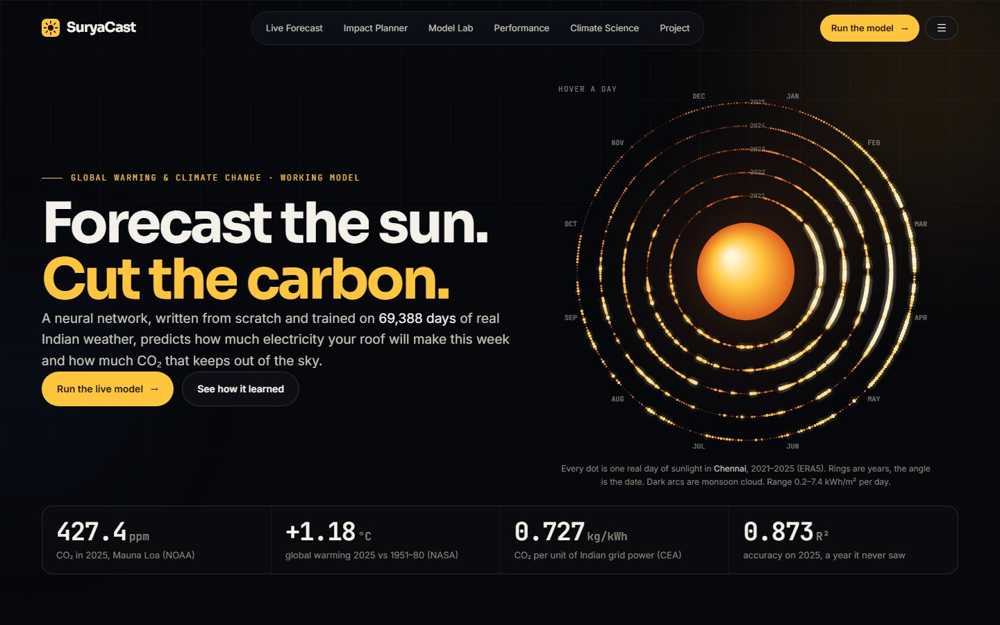
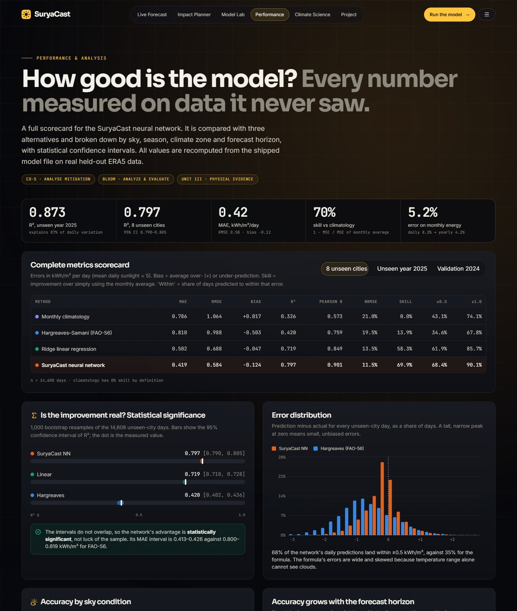
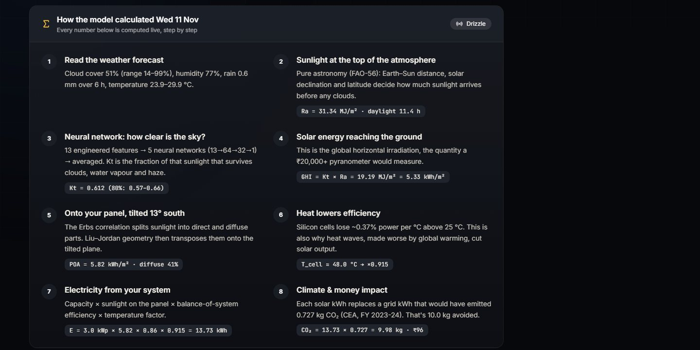
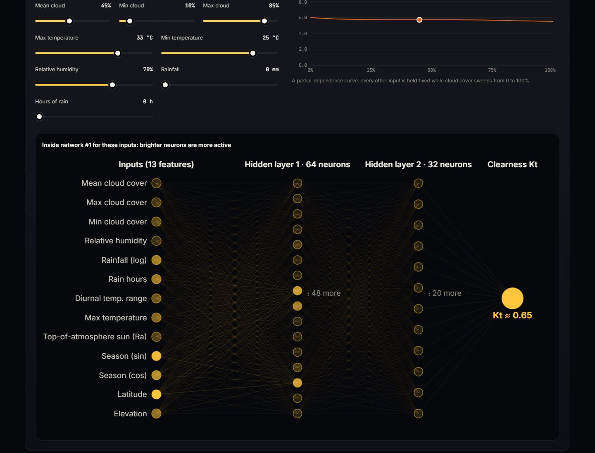
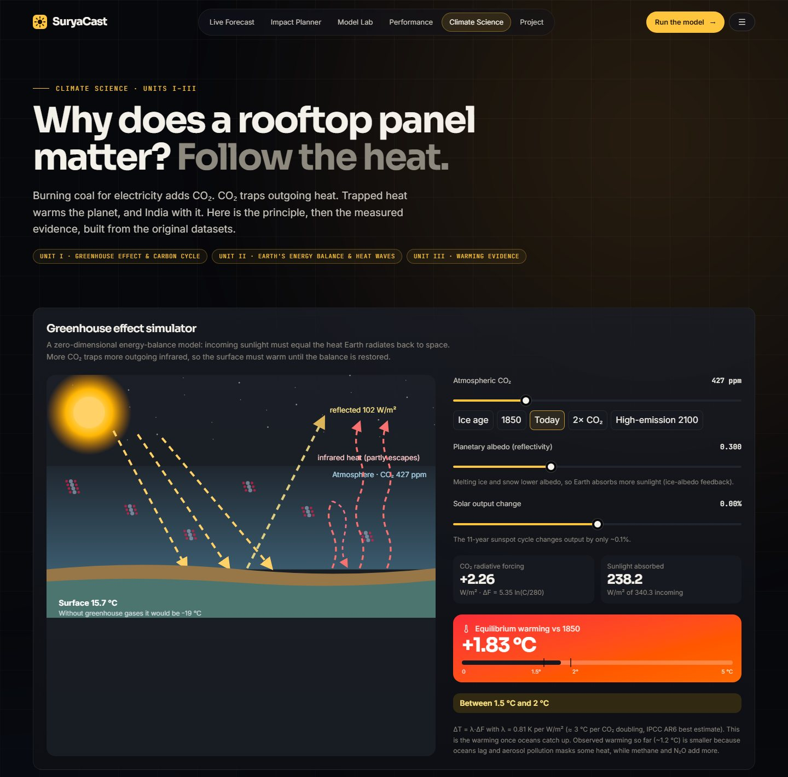
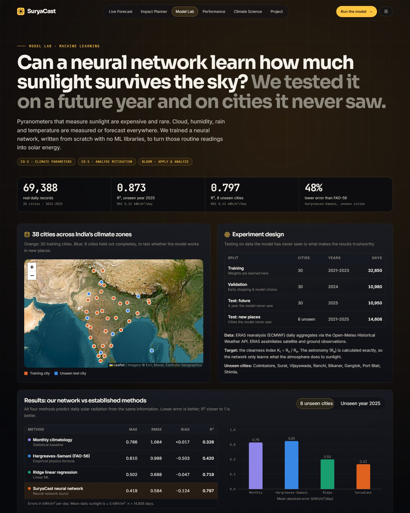
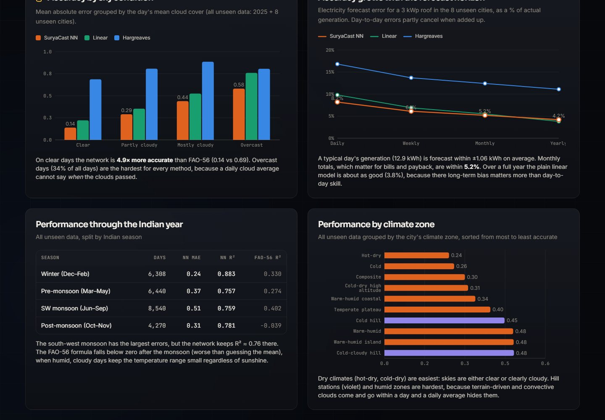
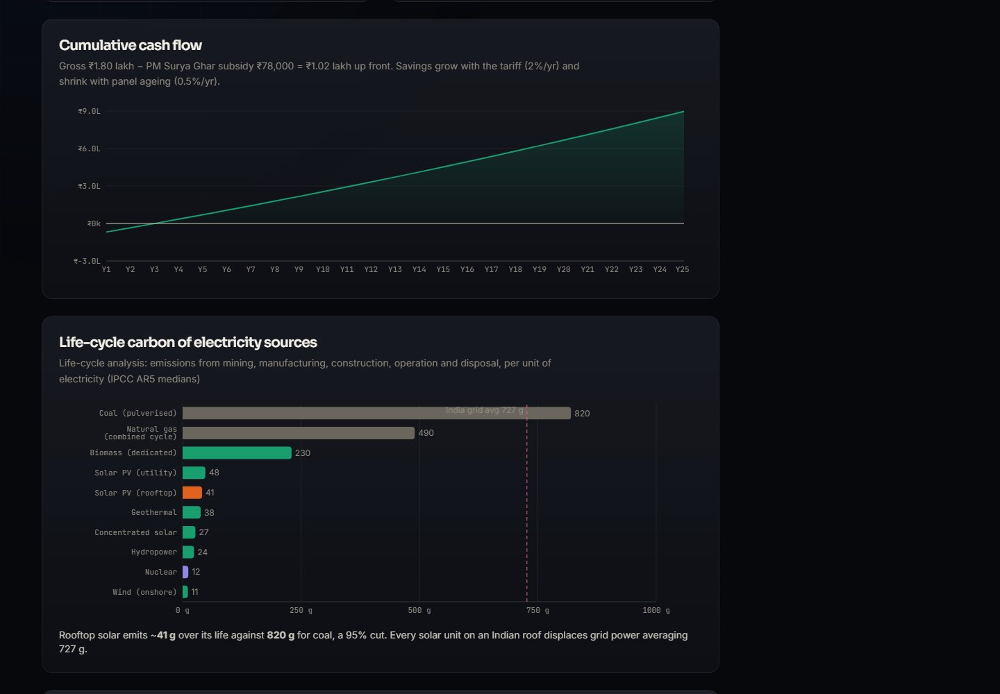
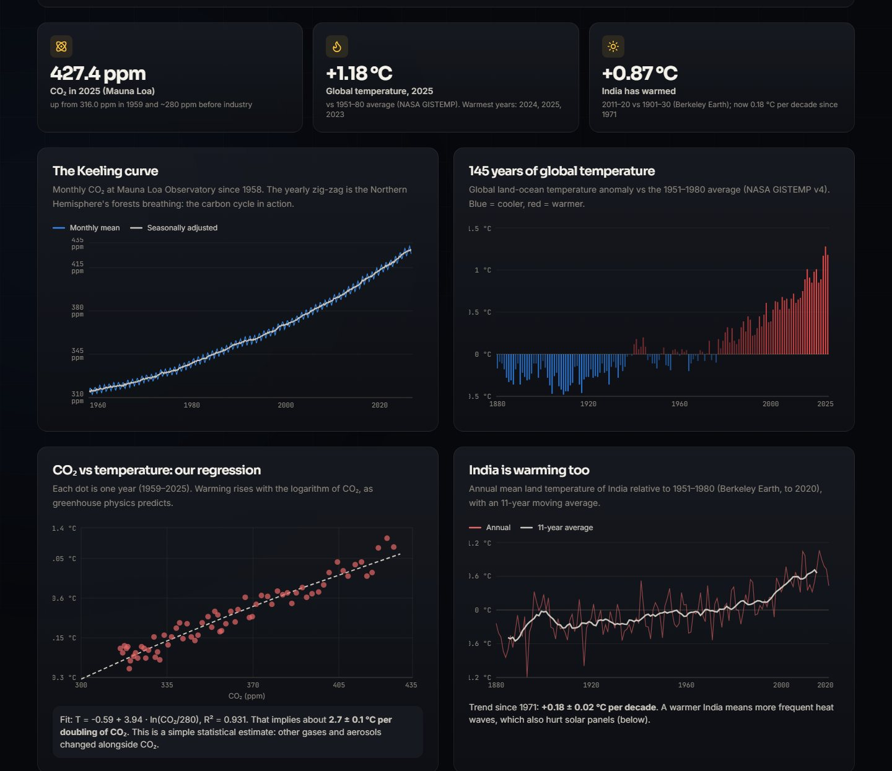
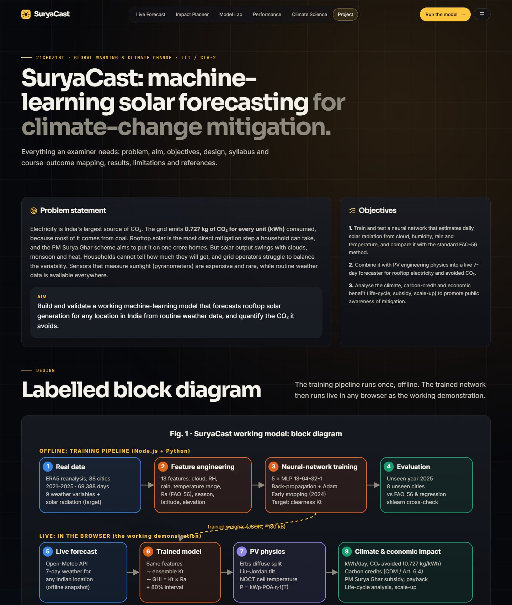

<div align="center">

# ☀️ SuryaCast

### Forecast the sun. *Cut the carbon.*

**India's grid emits 0.727 kg of CO₂ for every unit of electricity. Rooftop solar is the most direct fix a household has, but clouds and the monsoon make it unpredictable.**<br>
A neural network written from scratch learns how much sunlight survives the sky from routine weather. It then forecasts any Indian rooftop's electricity, CO₂ avoided, carbon credits and savings, live in the browser.




**Live demo:** [https://suryacast.vercel.app](https://suryacast.vercel.app)<br>
[The idea](#idea) · [Results](#results) · [The working model](#model) · [How it works](#how) · [Climate science](#science) · [What it cannot claim](#limits) · [Screenshots](#screenshots) · [Run it](#run)

</div>

---

## 📌 At a glance

| 📅 Real days of data | 🏙️ Cities | 🧠 Networks (13-64-32-1) | 🎯 R², unseen year | 🗺️ R², unseen cities | 📉 Error vs FAO-56 | ✅ Tests |
|:---:|:---:|:---:|:---:|:---:|:---:|:---:|
| **69,388** | **38** | **5** | **0.873** | **0.797** | **−48%** | **44** |

Working model for **21CEO310T · Global Warming and Climate Change** (LLT / CLA-2), SRM Institute of Science and Technology.

---

<a id="idea"></a>
## 💡 The idea

Pyranometers, the sensors that measure sunlight, cost tens of thousands of rupees and are rare. Cloud, humidity, rain and temperature are measured or forecast everywhere. So SuryaCast asks:

> Can a model learn, from routine weather alone, how much of the sun's energy makes it through the sky to an Indian rooftop?

The network predicts the **clearness index** K<sub>t</sub>, the fraction of top-of-atmosphere sunlight that reaches the ground. The astronomy (R<sub>a</sub>, from the FAO-56 equations) is computed exactly, so the network only has to learn what clouds, water vapour and haze do. Solar-engineering physics then turns sunlight into kWh, and kWh into CO₂ avoided.

| | Who | What they get |
|:---:|---|---|
| 🏠 | A household | This week's rooftop kWh, a year's savings, the PM Surya Ghar subsidy and payback, and the best days to run heavy loads |
| ⚡ | A grid operator | A cheap day-ahead estimate of rooftop generation, so less fossil back-up is kept spinning |
| 🌍 | A student or teacher | The full chain, from greenhouse effect to evidence to mitigation, with real numbers for their own city |

---

<a id="results"></a>
## 🧪 Results on data it never saw

The network trained on 30 cities from 2021 to 2023 and stopped early on 2024. It was tested on **2025** and on **8 cities it never saw** (Coimbatore, Surat, Vijayawada, Ranchi, Bikaner, Gangtok, Port Blair, Shimla).

| Method | R², year 2025 | MAE | R², 8 unseen cities | MAE | Skill vs climatology |
|---|:---:|:---:|:---:|:---:|:---:|
| Monthly climatology | 0.318 | 0.76 | 0.326 | 0.79 | 0% |
| Hargreaves–Samani (FAO-56) | 0.480 | 0.76 | 0.420 | 0.81 | 14% |
| Ridge linear regression | 0.746 | 0.46 | 0.719 | 0.50 | 58% |
| **SuryaCast neural network** | **0.873** | **0.31** | **0.797** | **0.42** | **70%** |

<sub>MAE in kWh/m² per day; mean daily sunlight ≈ 5 kWh/m².</sub>

- **Statistically significant:** 1,000 bootstrap resamples give R² 95% CIs of **0.790–0.805** (network) and **0.402–0.436** (FAO-56). They do not overlap.
- **Honest uncertainty:** the 80% prediction bands contain the truth **80.0%** of the time on 2025 and **77.9%** in new cities. New places get wider bands, calibrated by leave-cities-out cross-validation (R² **0.808 ± 0.075**).
- **Useful for planning:** daily electricity error is 8.2%, but **monthly totals are within 5.2%**.
- **Clear days:** the network is **4.9× more accurate** than FAO-56. Overcast monsoon days are hardest for every method.
- **Independent check:** scikit-learn's MLP, Random Forest and Gradient Boosting on the same features score R² 0.785–0.875. The hand-written network is on par.



---

<a id="model"></a>
## 🛰️ The working model

Pick any place in India (a city, GPS, or a click on your own roof in satellite imagery). SuryaCast fetches the live 7-day forecast, runs the five networks in the browser and shows:

- daily kWh with 80% bands, CO₂ avoided, bill savings and the sunniest day
- an **8-step breakdown** of any day: weather → R<sub>a</sub> → K<sub>t</sub> → GHI → tilted panel → cell temperature → kWh → CO₂
- a live cross-check against the weather model's own physics-based radiation (r = 0.96 for Chennai when tested on 6 Nov 2026)




The **Impact Planner** replays five real years for the location: monthly yield (with the monsoon dip), system sizing, carbon credits (Kyoto CDM → Paris Article 6.4 → India CCTS), PM Surya Ghar subsidy, payback, life-cycle emissions (IPCC) and a scale-up to one crore homes.


---

<a id="how"></a>
## ⚙️ How it works

| Step | What happens | Code |
|---|---|---|
| Data | ERA5 daily reanalysis for 38 cities, 2021–2025, via the Open-Meteo archive API (cached) | `ml/fetch_data.py`, `ml/data/raw/` |
| Features | 13 inputs: cloud mean/max/min, humidity, log rain, rain hours, temperature range, Tmax, R<sub>a</sub>, season sin/cos, latitude, elevation | `src/lib/ml/features.ts` |
| Network | MLP 13-64-32-1, leaky ReLU, MSE, Adam with cosine decay, early stopping; 5 seeds averaged | `src/lib/ml/mlp.ts` |
| Selection | 4 architectures compared on the 2024 validation year | `scripts/train.ts` |
| Uncertainty | Residual quantiles per K<sub>t</sub> bin; wider bands for new sites from 5-fold leave-cities-out CV | `scripts/train.ts` |
| PV physics | Erbs diffuse fraction, Liu–Jordan tilt, NOCT cell temperature, temperature coefficient | `src/lib/solar.ts`, `src/lib/pv.ts` |
| Impact | CEA 0.727 kg CO₂/kWh, PM Surya Ghar slabs, IPCC AR5 life-cycle, degradation, payback | `src/lib/carbon.ts` |
| Analysis | Metrics, bootstrap CIs, error by sky / season / zone / horizon, recomputed from the shipped model | `scripts/analyze.ts` |

Forward pass, back-propagation and Adam are about 250 lines of TypeScript with **no ML library**. The same code trains in Node and in the browser: the Model Lab trains a fresh network live in about 2 seconds.



---

<a id="science"></a>
## 🌍 Climate science

A zero-dimensional **energy-balance simulator** (ΔF = 5.35 ln(C/280), ≈3 °C per CO₂ doubling) and real evidence: the NOAA Keeling curve, NASA GISTEMP, Berkeley Earth's India record (+0.87 °C, now 0.18 °C per decade) and our own CO₂–temperature regression (≈2.7 °C per doubling, R² 0.93). There is also the heat-wave penalty on solar panels.



| Unit | Where it appears |
|---|---|
| I · Earth's climate system | Greenhouse simulator, Keeling curve (carbon cycle), radiative forcing |
| II · Climate indices & extremes | Earth's energy balance, monsoon variability, heat waves |
| III · Physical evidence | NOAA / NASA / Berkeley Earth records, energy generation and emissions |
| IV · International responses | Carbon credits, CDM, Paris Article 6.4, IPCC data, Paris 1.5 / 2 °C limits |
| V · Adaptation & mitigation | Solar energy, life-cycle analysis, PM Surya Ghar, sustainable development |

---

<a id="limits"></a>
## ⚠️ What it cannot claim

- Trained and tested on **ERA5 reanalysis**, not ground pyranometers. ERA5 can overestimate sunshine under heavy aerosol haze.
- **Daily** resolution only. Overcast and monsoon days are the hardest (MAE 0.58 kWh/m² when cloud > 80%).
- Weakest in complex terrain: Coimbatore (Palghat Gap) R² 0.55, Gangtok 0.73.
- Live accuracy also depends on the weather forecast it is fed.
- Shading, dust, roof orientation and wiring are simplified. Costs, tariff and credit price are editable assumptions.

---

<a id="screenshots"></a>
## 🖼️ Screenshots

| | |
|:---:|:---:|
| <br>Model Lab | <br>Error by sky and horizon |
| <br>Cash flow and life-cycle carbon | <br>Climate evidence |
| <br>Project, syllabus and diagram | <br>Landing page |

---

<a id="run"></a>
## 🚀 Run it

```bash
npm install
npm run dev            # http://localhost:5173
npm test               # 44 tests: FAO-56 worked examples, gradient checks, shipped-model accuracy
npm run build          # static site in dist/
```

Reproduce every number from the raw data:

```bash
python ml/fetch_data.py        # ERA5 (cached in ml/data/raw), NOAA, NASA, Berkeley Earth
npm run train                  # features, baselines, architecture search, ensemble, CV, reports
npm run prepare-climate        # climate evidence
npm run analyze                # performance & error analysis of the shipped model
python ml/crosscheck.py        # independent scikit-learn check (needs scikit-learn, pandas)
```

Screenshots: `bash scripts/screenshots.sh` against `npx vite preview --port 4173` (uses `?capture` mode).

<details>
<summary>Project structure</summary>

```
src/lib/ml/        neural network, features, metrics, ridge, in-browser trainer
src/lib/           solar geometry (FAO-56), PV model, carbon & economics, energy balance
src/pages/         Home, Forecast, Planner, Model Lab, Performance, Science, Project
src/data/          model report, performance analysis, climate evidence, sklearn cross-check
public/model/      trained 5-network ensemble (JSON)
public/data/       per-city 5-year history, training-lab sample, offline forecast snapshot
scripts/           train.ts, analyze.ts, prepare-climate.ts, screenshots.sh, report/
ml/                data download, cities, scikit-learn cross-check, raw ERA5 cache
tests/             vitest suites
```

</details>

## 📚 Data & credits

ERA5 reanalysis (Copernicus / ECMWF) via [Open-Meteo](https://open-meteo.com) (CC BY 4.0) · NOAA GML Mauna Loa CO₂ · NASA GISTEMP v4 · Berkeley Earth · CEA CO₂ Baseline Database v20 · MNRE PM Surya Ghar · IPCC AR5 / AR6 · Esri World Imagery.

MIT © 2026 Kavin Krish
